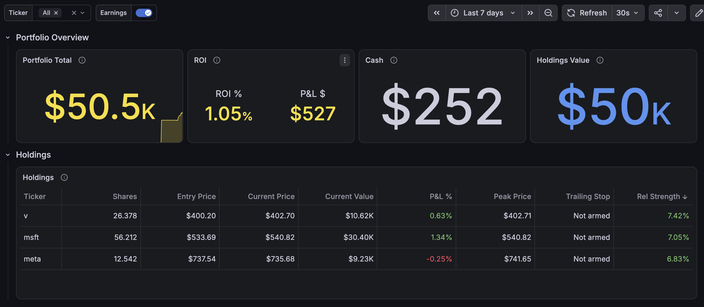
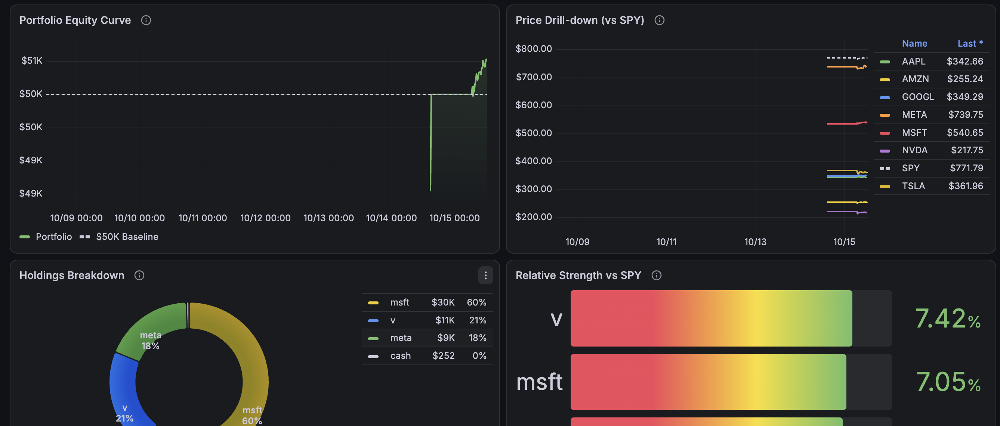

# Stock-Market-Challenge

An autonomous **mock stock trading portfolio manager**. It starts with $50,000 of
paper money, trades a core universe (SPY, AAPL, MSFT, GOOGL, AMZN, META, NVDA,
TSLA) plus a small daily watchlist found by headline scanning, and tries to beat
the S&P 500. No real money is ever involved.

## Features

- **News monitoring** - headline scanning and sentiment scoring, cached locally.
- **Technical analysis** - moving averages, RSI, momentum and relative strength vs. SPY (via yfinance).
- **Risk management** - stop losses and position sizing; long-only, no shorting, options or margin, cash never negative.
- **Earnings avoidance** - holdings are exited and buys skipped within 3 trading days of earnings (`EARNINGS_EXIT_DAYS`).
- **Monitoring** - Prometheus metrics and a provisioned Grafana dashboard.

## Dashboard Preview




## Architecture

| Component | File | Role |
|---|---|---|
| Trading cycle | `app/trading_cycle.py` | One rebalance cycle: read portfolio, score tickers, execute trades |
| Investment model | `app/investment_model.py`, `app/tech_analysis.py`, `app/risk.py` | News sentiment + technical composite score, stops and sizing |
| Trade ledger | `app/log_trade.py` | Validates and appends trades to `trades.csv` (the source of truth) |
| Portfolio exporter | `app/app.py` | Flask on :8081 (`/metrics`, `/holdings`, `/portfolio`) |
| Other exporters | `app/exporters/` | Prices on :8080, trade table on :8082 |
| Monitoring stack | `prometheus.yml`, `monitoring/` | Prometheus scrapes the exporters; Grafana dashboard visualises them |
| Config | `app/config.py` | All tunable constants (universe, stops, thresholds) |

The portfolio is rebuilt from `trades.csv` (`date,ticker,action,shares,price`)
on every cycle.

## Installation

**Requires Raspberry Pi OS / Debian** (Python 3.11+, a non-root user with `sudo`).
Other distributions are not supported.

See [SETUP.md](SETUP.md) for the full guide, manual steps and troubleshooting.

## Quick start

```bash
git clone https://github.com/davepae/Stock-Market-Challenge.git
cd Stock-Market-Challenge
./install.sh                 # installs packages, venv, Prometheus, Grafana, services
./verify.sh                  # every line should say PASS

cd ~/stocks_challenge && source .venv/bin/activate
python trading_cycle.py                     # run one rebalance cycle
python log_trade.py AAPL BUY 10 200.00      # log a trade manually
```

Grafana: `http://<pi-address>:3000` (initial login `admin` / `admin`) ->
Dashboards -> **Mock Stock Challenge**. Rules and strategy are in
[app/USER_GUIDE.md](app/USER_GUIDE.md).

## Disclaimer

Educational paper-trading software. Not financial advice.

## License

MIT License. See [LICENSE](LICENSE).
